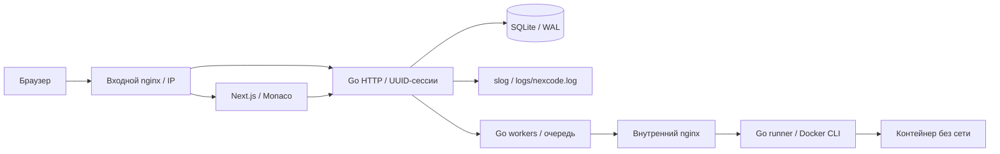
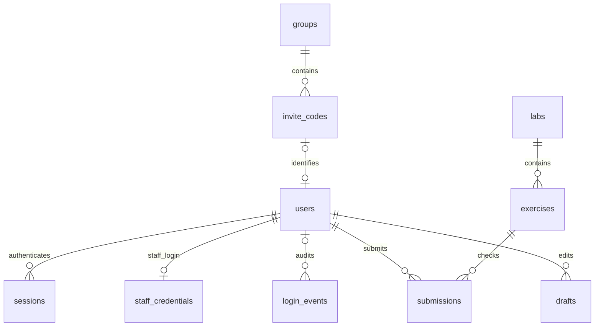

# Архитектура

`cmd/server` собирает приложение; `internal/httpapi` — REST, роли и валидация; `internal/auth` — UUID-сессии и служебные пароли; `internal/store` — SQLite и миграции; `internal/engine` — JSON Lines, очередь и отчёты; `cmd/runner` — изолированное исполнение. Небезопасного локального Python-режима нет.

users хранит full_name, group_name, invite_code_id, role, session_uuid, last_login_at, last_login_ip, created_at и blocked. Пароля/e-mail в ней нет. Для обычных ученических записей действует уникальный индекс ФИО + группа; разные приглашения позволяют полных тёзок. staff_credentials отдельно хранит служебный login и bcrypt-хэш. sessions — несколько UUIDv4 на пользователя, kind student/staff и expires. users.session_uuid является последним выданным UUID, а не ограничением числа устройств.

Новая идентификация, срок семестра, списки, журнал, API входа и миграция описаны в [identity.md](identity.md). Публичные endpoints register/forgot/reset удалены. Коды и служебные хэши не возвращаются студентам.

Практикум сохраняет REST:

| Путь | Доступ / назначение |
|---|---|
| GET /api/catalog | Авторизованный каталог со статусами |
| GET /api/exercises/:id | Условие, ограничения и первый тест-пример |
| GET/PUT /api/exercises/:id/draft | Только собственный черновик |
| POST /api/exercises/:id/submit | `{code,mode,stdin}` → 202 с ID очереди |
| GET /api/submissions | Свои отправки; `all=1` только для преподавателя |
| GET /api/submissions/:id | Владелец/преподаватель: код и отчёт |
| GET /api/teacher/students | ФИО, группы и прогресс |
| GET /api/teacher/export | CSV прогресса |
| PATCH /api/teacher/submissions/:id/review | `{status: passed/revision, feedback}` — проверка письменной или свободной работы |
| GET /api/teacher/catalog | Каталог с полными тестами |
| POST/PUT/DELETE /api/teacher/labs и /:id | Лабораторные |
| POST/PUT/DELETE /api/teacher/exercises и /:id | Упражнения; отправки защищают от удаления |
| POST /api/teacher/import | Транзакционный импорт каталога |
| GET /api/admin/users | Пользователи без паролей и UUID |
| PATCH /api/admin/users/:id | Блокировка; смена служебной роли отдельно от student |
| GET /api/admin/metrics | Очередь, исполнители, сессии |

HTTP JSON в UTF-8; ошибки `{error: string}`. Все SQL-запросы параметризованы. Для браузерных изменений Origin должен совпадать с APP_URL. JWT заменён на серверные UUIDv4-сессии. Код студента никогда не получает cookie или runner-токен.

История и черновики долговечны в SQLite. Буфер очереди — в памяти; после рестарта незавершённые задания помечаются ошибкой. Stateless runner масштабируется репликами, SQLite остаётся в одном API. Перед копированием тома остановите backend либо используйте Online Backup API с учётом WAL.

Каталог practice встроен в Go-образ. labs/exercises имеют catalog_key и archived;
исторические записи сохраняются. exercise.kind различает python, python_review
и written. Ручная сдача создаёт статус review; преподаватель переводит его в
passed или revision с комментарием. Python-файлы реализованы в памяти дочернего
интерпретатора; реальное открытие файлов по-прежнему блокируется audit hook.
